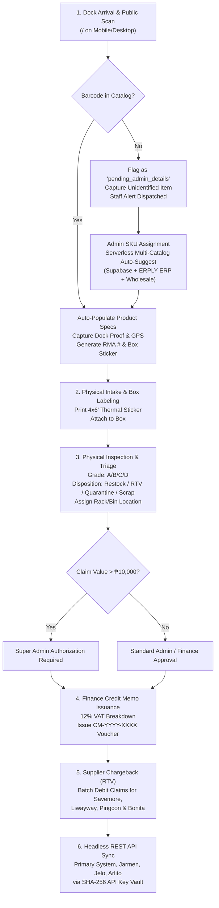
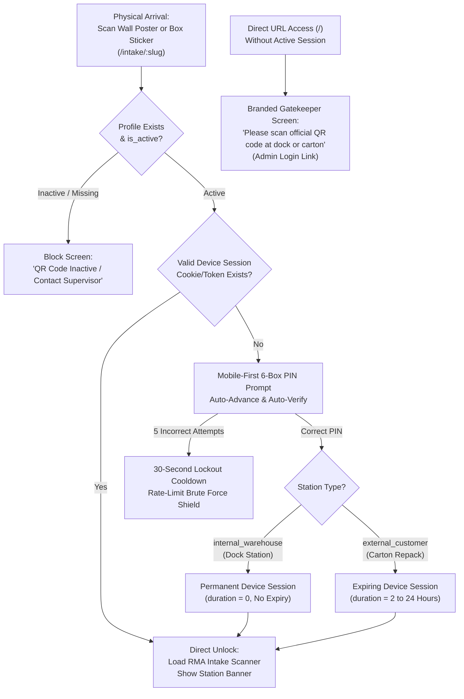

# Wholesale RMA Portal v2 — Comprehensive Operations Manual

**Document Version:** 2.1.0  
**Target Systems:** Public Intake Portal, Warehouse Operations, Finance & Credit Accounting, Supplier RTV, Headless REST API  
**Environment:** Production (`https://rma-portal-v2.vercel.app`)  
**Database Backend:** Supabase PostgreSQL (`lschluviltzsknptwgrz.supabase.co`)  
**ERP Integration:** Laravel Cloud Enterprise Catalog (`purchase-order-db-production-ff1oho.laravel.cloud`)  

---

## Executive Summary & Workflow Lifecycle

The Wholesale RMA Portal v2 is an enterprise reverse logistics and return merchandise authorization platform engineered for high-volume wholesale distribution (covering Pingcon Marketing, Bonita Mills, Keysys Incorporated, A2Z2GO Logistics Supply, and Savemore/Liwayway supplier lines).



---

## Chapter 1: Unified Role-Based QR Code & 6-Digit PIN Gatekeeper Engine

To prevent unauthorized public submissions while maintaining rapid frictionless intake for physical warehouse staff and verified customer returns, the portal employs the **Unified Role-Based QR Code & 6-Digit PIN Gatekeeper Engine**.



### 1.1 Database Architecture (`public.portal_access_keys`)
The security layer is backed by PostgreSQL table `public.portal_access_keys` in Supabase:
- `id uuid PRIMARY KEY DEFAULT gen_random_uuid()`: Globally unique identifier.
- `name text NOT NULL`: Station identifier (e.g., "Main Warehouse Floor", "Customer Delivery Boxes").
- `type text NOT NULL CHECK (type IN ('internal_warehouse', 'external_customer'))`: Role profile classification.
- `access_slug text UNIQUE NOT NULL`: Routing slug for printable QR URLs (`https://rma-portal-v2.vercel.app/intake/:slug`).
- `pin_code varchar(6) NOT NULL`: Secure 6-digit numeric PIN for station unlocking.
- `session_duration_hours integer DEFAULT 0`: Session lifetime (`0` = Permanent / No Expiry for internal warehouse devices; `>0` e.g. 2, 4, 24 hours for customer devices).
- `is_active boolean DEFAULT true`: Instant remote kill switch to deactivate lost posters or decommissioned boxes.
- `created_by text`, `created_at timestamptz`, `updated_at timestamptz`: Audit timestamps and creator metadata.

**Seed Profiles:**
1. **Main Warehouse Floor**: `internal_warehouse`, Slug `/intake/dock`, PIN `123456`, Duration `0` (Permanent).
2. **Customer Delivery Boxes**: `external_customer`, Slug `/intake/returns`, PIN `654321`, Duration `2` (2 Hours per device).

### 1.2 Device Session Lifespan & Expiration Model
- **Warehouse Floor Devices (`internal_warehouse`)**: Designed for shared company zebra handhelds, tablets, and dock workstations. Once the supervisor enters the 6-digit PIN (`123456`), the encrypted session token persists indefinitely in `localStorage`. Warehouse personnel can report hundreds of returns daily without repeated PIN interruptions.
- **Customer Carton Scanners (`external_customer`)**: Designed for retail store repackers scanning QR stickers taped onto delivery boxes. When scanned, the customer enters the box PIN (`654321`) and receives a strict 2-hour session. Once 2 hours elapse, the session token automatically self-terminates, preventing unauthorized subsequent submissions from outside the store.

### 1.3 Anti-Brute-Force Rate Limiting
- The PIN input utilizes a 6-box auto-advancing, mobile-optimized component.
- If an incorrect PIN is entered, the modal performs an error shake animation, clears the inputs, and decrements remaining attempts.
- If 5 consecutive failures occur within 2 minutes, the engine locks the device for **30 seconds** with a visible countdown timer, neutralizing automated brute-force attacks.

### 1.4 Admin QR Access Keys & PIN Manager UI
Restricted strictly to authenticated `SUPER_ADMIN` and `ADMIN` personnel:
- Accessible via **"QR Keys & PINs"** in the top navigation and tab bar.
- **Dynamic Profile Creation**: "+ New QR Access Code" generates custom slugs and random 6-digit PINs.
- **Instant PIN & Expiry Modification**: Administrators can change PINs or adjust expiry hours without reprinting posters.
- **High-Resolution Poster & Sticker Printing**: Renders print-ready A4 or 4x6" sheets with the generated station QR code, instructions, and an optional PIN visibility toggle.
- **1-Click Revocation**: Toggling status to `Inactive` immediately blocks all inbound scans from that profile.

---

## Chapter 2: Physical Dock Arrival & Initial Intake

### 1.1 Mobile & Desktop Scanning Workflow
When a delivery truck, return pallet, or customer shipment arrives at the warehouse unloading bay, the receiving clerk or customer uses the responsive Public Intake Portal at `https://rma-portal-v2.vercel.app/`:

1. **Barcode / QR Code Capture**:
   * **Mobile Camera Scanning**: Tapping **"Scan with Phone Camera"** launches the integrated `html5-qrcode` camera overlay with automatic environment/back-camera selection (`facingMode: 'environment'`). The scanner continuously samples video frames at 10 FPS with a responsive QR viewfinder.
   * **Hardware Barcode Scanners & Keyboard Entry**: Dock stations equipped with USB or Bluetooth HID handheld laser scanners (e.g., Keysys 2D Desktop Scanner) can scan directly into the `#barcode-input` field. An automatic 300ms debounce captures Code128, EAN-13, UPC-A, and custom QR codes.
   * **Quantity Multiplier**: Clerk increments or decrements quantity using the `+` / `-` stepper buttons (minimum 1, default 1).

2. **Server-Side Catalog Resolution**:
   * The barcode is sent to the serverless proxy endpoint `GET /api/v1/products/lookup?barcode=[code]`.
   * **Priority 1**: Supabase `public.products` table (`barcode = code` or `code = code`).
   * **Priority 2**: ERPLY POS/ERP live cloud catalog (`/data/erply_products` indexed across `ean_code`, `code2`, and SKU `code`).
   * **Priority 3**: Verified Wholesale Catalog fallback (`BON-FT-200`, `KEY-POS-T1`, `A2Z-BOX-M`, etc.).
   * If recognized, product name, net unit price, 12% VAT price, supplier, unit of measure (`pc`, `box`, `roll`, `unit`), and assigned Customer Account Executive (AE) auto-populate instantly.
   * If uncatalogued, the portal flags the submission as `Unidentified Item`, allowing intake to continue without blocking dock operations while queueing the item for Admin SKU enrichment.

3. **Mandatory Proof Photos & Supabase Storage**:
   * Intake strictly requires at least **1 proof photograph** demonstrating defect, crushed packaging, or carton condition.
   * Tapping **"Tap to Take Photo with Camera or Upload"** allows multi-file selection or immediate live camera snapshots.
   * **Automatic Client-Side Image Compression**: High-resolution mobile photos (often 5–15 MB) are automatically compressed in-memory via HTML5 Canvas to a maximum dimension of 1600px at 82% JPEG quality. This cuts upload times from 15 seconds to under 400ms while preserving defect visual clarity.
   * Compressed binary blobs are uploaded directly to the Supabase Storage bucket **`rma-photos`** under unique timestamps: `rma_proofs/${Date.now()}_${Math.random().toString(36).substring(7)}.jpg`.

4. **Accurate Dock GPS Geofencing Threshold Check**:
   * The portal invokes `navigator.geolocation.getCurrentPosition()` with `{ enableHighAccuracy: true, timeout: 8000, maximumAge: 30000 }`.
   * **Anti-False Coordinate Filter**: Desktop computers and office Wi-Fi routers frequently return cellular/IP-approximated coordinates with inaccuracies exceeding 500–5,000 meters. The portal strictly enforces an accuracy threshold:
     ```javascript
     const isAccurateGps = pos.coords.accuracy <= 150; // Must be within ±150 meters
     ```
   * If accuracy is within 150m (physical mobile hardware GPS at the dock), `gps_latitude` and `gps_longitude` are recorded.
   * If accuracy exceeds 150m, false coordinates are rejected and stored as `null` to maintain 100% audit integrity.

5. **RMA Authorization Generation**:
   * Upon submission, the database generates an enterprise RMA number formatted as:
     `RMA-YYYY-MMDD-XXXX` (e.g., `RMA-2026-1028-9B2F`).
   * The record is committed to `public.rma_reports` with initial status `received_at_dock` (or `pending_admin_details` if uncatalogued).
   * An initial audit trail event is appended to `audit_trail`:
     ```json
     {
       "timestamp": "2026-10-28T08:15:00.000Z",
       "stage": "INTAKE",
       "actor": "Danilo Alvaro Jr.",
       "note": "RMA intake recorded at warehouse dock"
     }
     ```

6. **Instant Box QR Sticker**:
   * The success screen provides an immediate **"Save Sticker (PNG)"** button.
   * Renders a 1200x1600 canvas sticker with:
     * High-contrast QR code pointing to `https://rma-portal-v2.vercel.app/?rma=RMA-...`
     * Auto-scaled RMA number (26px–54px dynamic sizing to strictly prevent QR frame overlap)
     * Wrapped 2-line item description (up to 960px width)
     * Defect reason, quantity, reporter, and supplier pill
     * Dashed cut lines for affixing directly onto outer cartons.

---

## Chapter 2: Admin SKU Enrichment & Catalog Synchronization

When an uncatalogued item arrives, warehouse staff are never blocked from receiving physical stock. The system handles enrichment through a unified workflow.

### 2.1 Detection & Identification
1. Unidentified returns receive the amber badge `Pending Unknown` in the Admin **Return Reports** table.
2. The KPI counter **"Pending Unknown Barcodes"** on the dashboard highlights items awaiting catalog assignment.
3. Clicking **"Pending Unknown Barcodes"** opens the dedicated batch triage modal with instant search, pagination, and photo lightbox verification.

### 2.2 Server-Side Auto-Suggest & Enrichment
When an admin clicks **"Assign SKU"** from either:
- The Return Reports table row,
- The Mobile grid card,
- The Quick RMA Processing modal, or
- The Pending Barcodes modal:

The unified **`ProductEditModal`** opens with pre-filled barcode details:
1. **Live Multi-Catalog Auto-Suggest (`ProductAutoSuggest`)**:
   * Typing into either the **Product Name** or **SKU / Item Code** fields initiates a 300ms debounced server query.
   * Calls `/api/v1/products/lookup?search=[query]&limit=30` using the server's private ERP credentials.
   * Searches live ERPLY catalog (5,793+ wholesale SKUs) and local catalog simultaneously.
   * Selecting a suggested item instantly auto-populates:
     * Official SKU / Code (e.g., `BON-KT-2R`, `MH117P`)
     * Clean Catalog Name
     * Supplier Name (e.g., `Bonita Mills Inc.`, `Savemore`, `Liwayway Marketing`)
     * Net Unit Price & 12% VAT Price (`priceWithVat = price * 1.12`)
     * Unit of measure (`pc`, `box`, `pack`, `roll`)
2. **Customer Account Executive (AE) Assignment**:
   * System enforces mandatory assignment of an Account Executive from the employee directory:
     * Jaezelle Benito (`jaezelle.benito@pingconmarketing.com`)
     * Mary Jane Gan (`mgan@pingconmarketing.com`)
     * Arlito Gan (`azgan@pingconmarketing.com`)
3. **Database Cascading Update**:
   * Saving the product writes to `public.products` (upsert on `barcode`).
   * Automatically executes a cascading update across `public.rma_reports`:
     ```sql
     UPDATE public.rma_reports
     SET name = $name, code = $sku, price = $price, price_with_vat = $vat,
         supplier_name = $supplier, unit_name = $unit, ae_name = $ae_name,
         ae_email = $ae_email, status = 'logged'
     WHERE barcode = $barcode AND status = 'pending_admin_details';
     ```
   * Dispatches automated email notification to the assigned AE and management CCs containing product photo, return quantity, defect reason, and customer details.

---

## Chapter 3: Physical Inspection, Triage & 4x6" Thermal Printing

Once merchandise is physically sorted at the inspection benches, warehouse inspectors record physical condition and storage routing.

### 3.1 Direct Access from Return Reports Table
Inspectors do not need to switch tabs or scan codes again:
- **Clicking anywhere on a report row** in the Return Reports table opens the **Quick RMA Processing Modal**.
- **Clicking the RMA number link** (`RMA-2026-...`) opens the modal.
- **Clicking the "Inspect / Triage" button** opens the modal.

### 3.2 Condition Grading Standards
Inspectors select from 4 enterprise condition grades:
* **Grade A — Like New / Resellable**: Pristine factory packaging, seals intact. Suitable for immediate restocking to active pick locations.
* **Grade B — Damaged Packaging Only**: Carton crushed, torn exterior box, but inner product 100% intact and non-expired. Suitable for repackaging or discount wholesale clearance.
* **Grade C — Defective / Parts Only**: Electrical failure, broken components, leakage. Requires Return to Vendor (RTV) debit claim or component salvage.
* **Grade D — Total Loss / Scrap**: Expired food items, shattered glass, contaminated chemicals. Hazardous waste or authorized destruction.

### 3.3 Warehouse Disposition Routing
Inspectors select the physical disposition route:
1. **Restock to Inventory**: Generates positive inventory adjustment in WMS/ERP.
2. **Return to Vendor (RTV)**: Queues item for Chapter 5 Supplier Debit Claims.
3. **Quarantine**: Holds item pending manufacturer rep inspection or safety audit.
4. **Scrap / Dispose**: Marks item for certified destruction certificate.

### 3.4 Rack & Bin Location Tagging
Inspectors input the physical warehouse address (e.g., `RACK-03-BIN-A`, `BAY-2-PALLET-09`, `QUARANTINE-LOCKER`). This prints directly on box labels for pickers.

### 3.5 4x6" Thermal Box Label Printing
Tapping **"Print 4x6" Label"** launches the thermal printing layout engineered specifically for standard 4x6-inch (101.6mm x 152.4mm) direct thermal label printers (Zebra, TSC, Rongta, Xprinter):
* High-density Code128 machine-scannable barcode (`*RMA-YYYY-MMDD-XXXX*`)
* High-contrast 2D QR Code linking to digital audit trail
* Prominent Condition Grade and Disposition Callouts
* Assigned Rack/Bin location in 24pt bold monospaced typography
* Inspector name and timestamp
* Automatic audit trail logging in `rma_reports.audit_trail` (`stage: 'THERMAL_PRINT'`).

---

## Chapter 4: Finance Credit Memo Issuance & Threshold Governance

### 4.1 Credit Memo Calculation & VAT Rules
Finance officers review triaged returns to approve credit deductions for customers.
1. **Base Value**: Quantity $\times$ Unit Price (inclusive of 12% Philippine VAT).
   $$\text{Gross Amount} = \text{Quantity} \times \text{Price with VAT}$$
   $$\text{Net Amount} = \frac{\text{Gross Amount}}{1.12}$$
   $$\text{VAT Amount} = \text{Gross Amount} - \text{Net Amount}$$
2. **Deduction Percentage Buttons**: Quick-selection chips automatically calculate approved credit amounts:
   * **100%**: Full refund / credit for factory defects.
   * **75% / 50% / 25%**: Pro-rated credits for partial box returns, handling fees, or expired returns.
3. **Pull-Out Reference Number (POR)**: Automatically generated in enterprise format:
   `POR-YYYY-XXXX-XXXX` (e.g., `POR-2026-0004-8E1A`).

### 4.2 Multi-Tier Financial Governance (₱10,000 Rule)
To prevent unauthorized credit issuance on large wholesale claims:
* **Claims $\le$ ₱10,000**: Standard Admins, Inventory Staff, and Finance Officers can approve and issue the credit memo immediately.
* **Claims $>$ ₱10,000 (High-Value Claims)**:
  * The system locks the **"Issue Credit Memo"** action button.
  * Displays an amber alert:
    > `High-Value Claim (> ₱10,000.00). Super Admin authorization required to issue credit memo.`
  * Only users authenticated with the **`super_admin`** role can approve and issue the credit memo.

### 4.3 Official Printable Credit Memo Voucher
Issued credit memos generate an official voucher (`CM-YYYY-XXXX`) compliant with BIR/wholesale accounting:
* Two-tone formal header with company seal
* Linked RMA number, Pull-Out Reference (POR), Pull-Out Date
* Line items with Gross Price, Net Price, 12% VAT amount, and Total Credit
* Triple signature blocks:
  1. *Prepared By (Warehouse/Dock)*
  2. *Verified By (Finance & Accounting)*
  3. *Approved By (General Manager / Super Admin)*
* One-click PDF / Print preview with bulk multi-voucher batch printing support.

---

## Chapter 5: Supplier Chargebacks & Return to Vendor (RTV)

When goods are triaged with disposition **"Return to Vendor (RTV)"**, the financial loss is charged back to the originating manufacturer or distributor.

### 5.1 Supported Supplier Accounts
* **Savemore / SM Markets**: High-volume retail returns (packaged foods, beverages, household supplies).
* **Liwayway Marketing Corporation**: Oishi snack and confectionery products.
* **Bonita Mills Inc.**: Facial tissue, kitchen towels, bathroom tissue, and hygiene lines.
* **Keysys Incorporated**: POS hardware, thermal receipt printers, and barcode scanners.
* **A2Z2GO Logistics Supply**: Packaging straps, cartons, and warehouse consumables.

### 5.2 Batch Claim Aggregation & Debit Note Generation
In the **Supplier Claims (RTV)** tab:
1. Filter returns by specific supplier (e.g., *Liwayway Marketing*).
2. Multi-select returned items using checkboxes.
3. The dashboard calculates:
   * Total Selected Items Count
   * Total Physical Units
   * Total Claim Debit Value (₱)
4. Tapping **"Generate RTV Debit Claim"** bundles selected returns into a formal supplier chargeback claim.
5. Export formal CSV reports for supplier credit accounting or print supplier debit vouchers.

---

## Chapter 6: Headless REST API Architecture (Enterprise System Integration)

The RMA Portal provides a secure, headless OpenAPI 3.1 REST API allowing external ERPs, warehouse management systems, and partner software to integrate seamlessly.

### 6.1 Integrated Partner Systems & Key Vault
API access is governed by the SHA-256 Key Vault in `public.api_keys`. Secret keys are generated using cryptographically secure random bytes:
`rma_live_[32 characters]` (e.g., `rma_live_demo_hash_vault_key_2026`).

Only the SHA-256 hash is stored in the database. The plain key is displayed **once** upon generation.

| Partner System ID | Name | Role | Permitted Endpoints |
| :--- | :--- | :--- | :--- |
| `primary` | Primary System (Mine) | Internal Central System | Full Read/Write (`/api/v1/*`) |
| `jarmen` | Jarmen | Partner Wholesale System | Products, RMA Submission, Status |
| `jelo` | Jelo | Partner Operations System | RMA Intake, Triage, Physical Disposition |
| `arlito` | Arlito | Partner Inventory System | Catalog Query, Credit Memos Read |

### 6.2 Authentication Header
All REST requests must include the API key in the `X-API-Key` HTTP header:
```http
GET /api/v1/rma HTTP/1.1
Host: rma-portal-v2.vercel.app
X-API-Key: rma_live_demo_hash_vault_key_2026
Accept: application/json
```

### 6.3 Endpoints Reference Map
All API routes are served under `https://rma-portal-v2.vercel.app`:

| Method | Endpoint | Auth | Purpose |
| :--- | :--- | :---: | :--- |
| `GET` | `/docs` | Public | Interactive Scalar OpenAPI 3.1 Reference & Swagger UI |
| `GET` | `/api/openapi.json` | Public | Machine-readable OpenAPI 3.1 JSON Specification |
| `GET` | `/api/v1/health` | Public | Real-time database & SMTP health check |
| `GET` | `/api/v1/products/lookup` | Public/Proxy | Barcode & SKU lookup across Supabase & ERPLY |
| `GET` | `/api/v1/products` | `X-API-Key` | Search & list wholesale product master catalog |
| `POST` | `/api/v1/products` | `X-API-Key` | Create or update product item specs |
| `GET` | `/api/v1/products/:id` | `X-API-Key` | Get single product by numeric ID or barcode |
| `PATCH` | `/api/v1/products/:id` | `X-API-Key` | Update product price, AE, or details |
| `DELETE`| `/api/v1/products/:id` | `X-API-Key` | Delete product from catalog |
| `GET` | `/api/v1/rma` | `X-API-Key` | List return reports with pagination & filters |
| `POST` | `/api/v1/rma` | `X-API-Key` | Submit programmatic RMA return ticket |
| `GET` | `/api/v1/rma/:id` | `X-API-Key` | Retrieve single RMA report & triage specs |
| `PATCH` | `/api/v1/rma/:id` | `X-API-Key` | Update triage grade, disposition, or rack/bin |
| `DELETE`| `/api/v1/rma/:id` | `X-API-Key` | Super admin delete RMA report |
| `GET` | `/api/v1/credit-memos` | `X-API-Key` | List finance credit memos |
| `POST` | `/api/v1/credit-memos` | `X-API-Key` | Issue official credit memo (enforces ₱10K rule) |
| `GET` | `/api/v1/credit-memos/:id` | `X-API-Key` | Retrieve credit memo voucher details |
| `POST` | `/api/v1/api-keys` | Super Admin | Generate & issue new SHA-256 partner key |
| `PATCH` | `/api/v1/api-keys/:id` | Super Admin | Toggle key status, update rate limit |
| `DELETE`| `/api/v1/api-keys/:id` | Super Admin | Revoke partner API key |

### 6.4 Rate Limiting & Security Governance
* Default rate limit is **60 requests per minute** per key (configurable up to 300 req/min).
* Rate limits are tracked in-memory with automatic `429 Too Many Requests` status codes and `Retry-After: 60` headers.
* Key usage timestamps (`last_used_at`) update automatically on valid invocations.

---

## Chapter 7: Sandbox Test Mode vs. Live Operations

To ensure dock staff and administrators can train without corrupting production accounting:
1. **Strict Super Admin Gating**: Test Mode is strictly accessible only when authenticated as `super_admin`.
2. **Visual Awareness Banner**: When active, a prominent amber bar warns:
   > `⚡ Super Admin Sandbox Active — Submissions will simulate without sending real emails or dispatching warehouse stock.`
3. **Email Interception**: During test mode, email notifications are routed exclusively to `finance2@keysysincorporated.com` with a `[TEST SIMULATION]` subject prefix. Real customer and AE emails are completely blocked.
4. **Dock Worker Protection**: Unauthenticated mobile phone scans and dock staff tablets are **100% locked to Live Mode**, ensuring real incoming customer returns are never misfiled as simulations.
