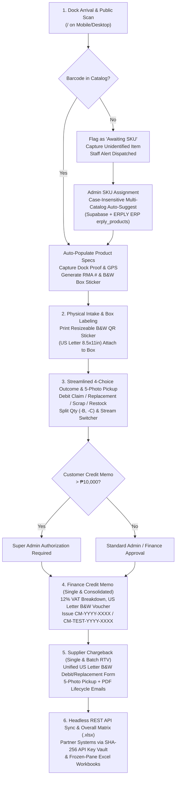
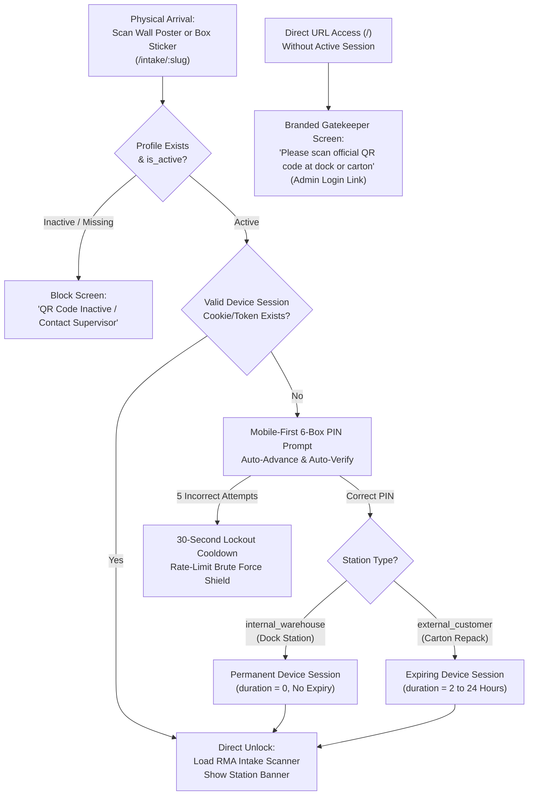

# Wholesale RMA Portal v2 — Comprehensive Operations Manual

**Document Version:** 2.1.0  
**Target Systems:** Public Intake Portal, Warehouse Operations, Finance & Credit Accounting, Supplier RTV, Headless REST API  
**Environment:** Production (`https://rma-portal-v2.vercel.app`)  
**Database Backend:** Supabase PostgreSQL (`lschluviltzsknptwgrz.supabase.co`)  
**ERP Integration:** Laravel Cloud Enterprise Catalog (`purchase-order-db-production-ff1oho.laravel.cloud`)  

---

## Executive Summary & Workflow Lifecycle

The Wholesale RMA Portal v2 is an enterprise reverse logistics and return merchandise authorization platform engineered for high-volume wholesale distribution (covering Pingcon Marketing, Bonita Mills, Keysys Incorporated, A2Z2GO Logistics Supply, and Savemore/Liwayway supplier lines).



### Consolidated Enterprise Operational Architecture

The Admin Workspace provides 4 crystal-clear, segregated operational hubs:
1. **Saved Products Catalog** (`adminActiveTab === 'products'`): Verified master SKU catalog with multi-vendor auto-suggest and ERP sync.
2. **Customer RMA Hub (Inbound Logistics)** (`adminActiveTab === 'customer_reports'`): Dedicated to supermarket and store branch returns (`rma_type: 'customer_inbound'`), billing document matching (SI#/DR#/PO#), and Customer Credit Memo issuance.
3. **Supplier Hub (RTV Claims)** (`adminActiveTab === 'supplier_claims'`): Unified vendor reverse logistics for warehouse floor defects (`rma_type: 'supplier_outbound'`) and RTV dispositions (`SupplierClaimsTab.jsx`), supporting single and batch vendor debit notes with sequential RTV IDs.
4. **Finance Credit Memos** (`adminActiveTab === 'credit_memos'`): Official accounting credit memorandum ledger, 12% VAT calculations, and printable vouchers.
5. **Settings & SMTP** (`adminActiveTab === 'settings'`, Super Admin Only): API key vault, Google SMTP notification configuration, and system diagnostics.

---

## Chapter 1: Unified Role-Based QR Code & 6-Digit PIN Gatekeeper Engine

To prevent unauthorized public submissions while maintaining rapid frictionless intake for physical warehouse staff and verified customer returns, the portal employs the **Unified Role-Based QR Code & 6-Digit PIN Gatekeeper Engine**.



### 1.1 Database Architecture (`public.portal_access_keys`)
The security layer is backed by PostgreSQL table `public.portal_access_keys` in Supabase:
- `id uuid PRIMARY KEY DEFAULT gen_random_uuid()`: Globally unique identifier.
- `name text NOT NULL`: Station identifier (e.g., "Main Warehouse Floor", "Customer Delivery Boxes").
- `type text NOT NULL CHECK (type IN ('internal_warehouse', 'external_customer'))`: Role profile classification.
- `access_slug text UNIQUE NOT NULL`: Routing slug for printable QR URLs (`https://rma-portal-v2.vercel.app/intake/:slug`).
- `pin_code varchar(6) NOT NULL`: Secure 6-digit numeric PIN for station unlocking.
- `session_duration_hours integer DEFAULT 0`: Session lifetime (`0` = Permanent / No Expiry for internal warehouse devices; `>0` e.g. 2, 4, 24 hours for customer devices).
- `is_active boolean DEFAULT true`: Instant remote kill switch to deactivate lost posters or decommissioned boxes.
- `created_by text`, `created_at timestamptz`, `updated_at timestamptz`: Audit timestamps and creator metadata.

**Seed Profiles:**
1. **Main Warehouse Floor**: `internal_warehouse`, Slug `/intake/dock`, PIN `123456`, Duration `0` (Permanent).
2. **Customer Delivery Boxes**: `external_customer`, Slug `/intake/returns`, PIN `654321`, Duration `2` (2 Hours per device).

### 1.2 Device Session Lifespan & Expiration Model
- **Warehouse Floor Devices (`internal_warehouse`)**: Designed for shared company zebra handhelds, tablets, and dock workstations. Once the supervisor enters the 6-digit PIN (`123456`), the encrypted session token persists indefinitely in `localStorage`. Warehouse personnel can report hundreds of returns daily without repeated PIN interruptions.
- **Customer Carton Scanners (`external_customer`)**: Designed for retail store repackers scanning QR stickers taped onto delivery boxes. When scanned, the customer enters the box PIN (`654321`) and receives a strict 2-hour session. Once 2 hours elapse, the session token automatically self-terminates, preventing unauthorized subsequent submissions from outside the store.

### 1.3 Anti-Brute-Force Rate Limiting
- The PIN input utilizes a 6-box auto-advancing, mobile-optimized component.
- If an incorrect PIN is entered, the modal performs an error shake animation, clears the inputs, and decrements remaining attempts.
- If 5 consecutive failures occur within 2 minutes, the engine locks the device for **30 seconds** with a visible countdown timer, neutralizing automated brute-force attacks.

### 1.4 Admin QR Access Keys & PIN Manager UI
Restricted strictly to authenticated `SUPER_ADMIN` and `ADMIN` personnel:
- Accessible via **"QR Keys & PINs"** in the top navigation and tab bar.
- **Dynamic Profile Creation**: "+ New QR Access Code" generates custom slugs and random 6-digit PINs.
- **Instant PIN & Expiry Modification**: Administrators can change PINs or adjust expiry hours without reprinting posters.
- **High-Resolution Poster Printing**: Renders print-ready US Letter (`8.5" x 11"`, `letter portrait`) sheets with the generated station QR code and instructions.
- **1-Click Revocation**: Toggling status to `Inactive` immediately blocks all inbound scans from that profile.

### 1.5 Unbypassable Cooldown Lockout System & Anti-Fraud Architecture

To prevent duplicate returns, spam submissions, and inventory tampering by external customer reporters, the portal incorporates a server-side **Unbypassable Cooldown Lockout Engine**.

#### 1. The Multi-Vector Bypass Vulnerability Solved
Previously, client-side session expiration stored strictly in browser `localStorage` or cookies could be bypassed if a user:
1. Cleared their browser cache and history.
2. Opened an Incognito / Private browsing window.
3. Switched browsers on the same phone (e.g. Chrome to Safari, Brave, Edge, or Firefox).

#### 2. Deterministic Physical Hardware Fingerprinting
The client calculates an immutable hardware signature via `src/utils/deviceFingerprint.js`:
- Queries the physical GPU vendor & renderer string via WebGL (`UNMASKED_RENDERER_WEBGL`).
- Queries Web Audio API oscillator frequency response and sample rate.
- Analyzes hardware concurrency (CPU cores), device pixel ratio, and physical display dimensions.
- Produces a high-entropy SHA-256 hardware hash that remains **identical across Incognito tabs and different browsers on the same physical phone**.

#### 3. Database Schema (`public.device_intake_sessions`)
Backed by a high-performance Supabase tracking table:
- `id`: `uuid PRIMARY KEY DEFAULT gen_random_uuid()`
- `profile_id`: `uuid REFERENCES public.portal_access_keys(id) ON DELETE CASCADE`
- `access_slug`: `text NOT NULL` (e.g., `returns`)
- `device_fingerprint`: `text NOT NULL` (deterministic hardware hash)
- `ip_address`: `text NOT NULL` (client network IP extracted from headers)
- `session_started_at`: `timestamptz DEFAULT now()`
- `session_expires_at`: `timestamptz NOT NULL` (e.g. `NOW() + 2 hours`)
- `cooldown_until`: `timestamptz NOT NULL` (e.g. `session_expires_at + 6 hours`)
- `status`: `text CHECK (status IN ('active', 'in_cooldown', 'expired'))`

#### 4. Server-Side Verification Endpoint (`/api/v1/auth/verify-pin`)
1. Receives `{ slug, pin, deviceFingerprint }` and client IP.
2. Checks if an active cooldown exists in `public.device_intake_sessions` where `NOW() < cooldown_until`.
3. If active, rejects authentication with HTTP `429 Too Many Requests`:
   ```json
   {
     "error": "COOLDOWN_ACTIVE",
     "message": "Return Window Currently Locked",
     "cooldownRemainingMinutes": 145,
     "unlocksAt": "2026-10-29T23:30:00Z"
   }
   ```
4. Renders the **Cooldown Lockout Screen** with a live ticking countdown timer (`HH:MM:SS`), support contact button, and Supervisor Override option.

#### 5. Admin Emergency Reset / Clear Cooldowns
If an authorized customer or technician urgently needs to submit returns before the cooldown period expires, an Admin can click **"Clear Cooldowns"** on the profile in the QR Keys & PINs Manager. This calls `/api/v1/auth/clear-cooldown`, instantly releasing all device lockouts.

---

## Chapter 2: Physical Dock Arrival & Initial Intake

### 1.1 Mobile & Desktop Scanning Workflow
When a delivery truck, return pallet, or customer shipment arrives at the warehouse unloading bay, the receiving clerk or customer uses the responsive Public Intake Portal at `https://rma-portal-v2.vercel.app/`:

1. **Barcode / QR Code Capture**:
   * **Mobile Camera Scanning**: Tapping **"Scan with Phone Camera"** launches the integrated `html5-qrcode` camera overlay with automatic environment/back-camera selection (`facingMode: 'environment'`). The scanner continuously samples video frames at 10 FPS with a responsive QR viewfinder.
   * **Hardware Barcode Scanners & Keyboard Entry**: Dock stations equipped with USB or Bluetooth HID handheld laser scanners (e.g., Keysys 2D Desktop Scanner) can scan directly into the `#barcode-input` field. An automatic 300ms debounce captures Code128, EAN-13, UPC-A, and custom QR codes.
   * **Quantity Multiplier**: Clerk increments or decrements quantity using the `+` / `-` stepper buttons (minimum 1, default 1).

2. **Server-Side Catalog Resolution**:
   * The barcode is sent to the serverless proxy endpoint `GET /api/v1/products/lookup?barcode=[code]`.
   * **Priority 1**: Supabase `public.products` table (`barcode = code` or `code = code`).
   * **Priority 2**: ERPLY POS/ERP live cloud catalog (`/data/erply_products` indexed across `ean_code`, `code2`, and SKU `code`).
   * **Priority 3**: Verified Wholesale Catalog fallback (`BON-FT-200`, `KEY-POS-T1`, `A2Z-BOX-M`, etc.).
   * If recognized, product name, net unit price, 12% VAT price, supplier, unit of measure (`pc`, `box`, `roll`, `unit`), and assigned Customer Account Executive (AE) auto-populate instantly.
   * If uncatalogued, the portal flags the submission as `Unidentified Item`, allowing intake to continue without blocking dock operations while queueing the item for Admin SKU enrichment.

3. **Tap-First Dual-Zone Photo Capture & Google Drive Subfolder Architecture**:
   * **Zone 1: Damaged Product Photo (Required)**: Max 3 photos of damaged carton, crushed packaging, or broken product seals. Files are compressed via client-side WebP canvas to $< 180\text{KB}$.
   * **Zone 2: Official Paperwork Photo (Optional / Recommended - Zero Typing UX)**: Warehouse clerks snap the paper Delivery Receipt (DR), Sales Invoice (SI), or Purchase Order (PO). The caption instructs: *"Don't type numbers! Snap your paper delivery receipt, DR, invoice, or PO."*
   * **Deferred Upload Guarantee (Zero Orphan Uploads)**: When users snap or upload photos in the intake form, images are held strictly in local browser memory via object URLs (`URL.createObjectURL`). **No network calls are made to Google Drive until the user officially clicks "Submit Return Report".** Abandoned, retaken, or unsubmitted photo sessions generate zero orphaned files on Google Drive.
   * **Automated Hierarchical Google Drive Storage**: Rather than dumping files into a single flat directory, images are sorted into structured 6-tier nested folders:
     ```
     Root: "Wholesale RMA Reports"
       └── [Customer Folder (e.g. Savemore Taguig) OR Supplier Folder (e.g. Liwayway Marketing)]
           └── [YYYY-MM] (e.g. 2026-11)
               └── [RMA_NUMBER] (e.g. RMA-20261103-9841)
                   ├── Proof of Damage/ (stores photos of defective merchandise)
                   └── Invoice/ (stores verified DR, SI, and PO photos)
     ```
   * Public preview URLs (`https://lh3.googleusercontent.com/d/{fileId}`) are saved directly to `rma_reports.photos` and `rma_reports.paperwork_photos`.
   * **Full Lifecycle Google Drive Asset Deletion**: When an administrator permanently deletes an RMA report (single or bulk), the system calls the Google Drive API (`DELETE` / `trashed: true`) to purge the entire dedicated RMA folder (`google_drive_folder_id`) and all nested photos, leaving zero orphaned files.

4. **Gemini Flash AI Paperwork Inspector & Unbiased Store / Branch Auto-Fill**:
   * **Instant Serverless OCR (`/api/v1/ai/inspect-paperwork`)**: Invokes Google Gemini Flash (`gemini-2.5-flash`) to validate document authenticity and extract `invoice_dr_number`, `store_branch`, `vendor_name`, and `detected_date`.
   * **Anti-Fraud Rejection Gate**: If a user uploads non-paperwork (food, floor, face, or unrelated item), the card shakes (`animate-shake`), the input clears, and a warning alert instructs the user to provide an official logistics receipt.
   * **Unbiased Store / Branch Location**: Manual input field with zero supplier bias (no hardcoded favoritism or preset dropdowns). If Gemini Flash detects the store/branch from the attached paperwork, it automatically populates the field with an *"Auto-filled from Paperwork"* indicator, while allowing the user to freely type or modify.
   * **Persistent Local Contact Info**: Reporter name and contact phone/email are cached in `localStorage` (`rma_reporter_name`, `rma_reporter_contact`), saving repeat drivers and warehouse clerks from ever having to re-type contact info.

5. **Accurate Dock GPS Geofencing Threshold Check**:
   * The portal invokes `navigator.geolocation.getCurrentPosition()` with `{ enableHighAccuracy: true, timeout: 8000, maximumAge: 30000 }`.
   * **Anti-False Coordinate Filter**: Desktop computers and office Wi-Fi routers frequently return cellular/IP-approximated coordinates with inaccuracies exceeding 500–5,000 meters. The portal strictly enforces an accuracy threshold:
     ```javascript
     const isAccurateGps = pos.coords.accuracy <= 150; // Must be within ±150 meters
     ```
   * If accuracy is within 150m (physical mobile hardware GPS at the dock), `gps_latitude` and `gps_longitude` are recorded.
   * If accuracy exceeds 150m, false coordinates are rejected and stored as `null` to maintain 100% audit integrity.

6. **RMA Authorization Generation**:
   * Upon submission, the database generates an enterprise RMA number formatted as:
     `RMA-YYYY-MMDD-XXXX` (e.g., `RMA-2026-1028-9B2F`).
   * The record is committed to `public.rma_reports` with initial status `received_at_dock` (or `pending_admin_details` if uncatalogued).
   * An initial audit trail event is appended to `audit_trail`:
     ```json
     {
       "timestamp": "2026-10-28T08:15:00.000Z",
       "stage": "INTAKE",
       "actor": "Danilo Alvaro Jr.",
       "note": "RMA intake recorded at warehouse dock"
     }
     ```

7. **Instant Box QR Sticker**:
   * The success screen provides an immediate **"Save Sticker (PNG)"** button.
   * Renders a 1200x1600 canvas sticker with:
     * High-contrast QR code pointing to `https://rma-portal-v2.vercel.app/?rma=RMA-...`
     * Auto-scaled RMA number (26px–54px dynamic sizing to strictly prevent QR frame overlap)
     * Wrapped 2-line item description (up to 960px width)
     * Defect reason, quantity, reporter, and supplier pill
     * Dashed cut lines for affixing directly onto outer cartons.

---

## Chapter 2: Admin SKU Enrichment & Catalog Synchronization

When an uncatalogued item arrives, warehouse staff are never blocked from receiving physical stock. The system handles enrichment through a unified workflow.

### 2.1 Detection & Identification
1. Unidentified returns receive the amber badge `Pending Unknown` in the Admin **Return Reports** table.
2. The KPI counter **"Pending Unknown Barcodes"** on the dashboard highlights items awaiting catalog assignment.
3. Clicking **"Pending Unknown Barcodes"** opens the dedicated batch triage modal with instant search, pagination, and photo lightbox verification.

### 2.2 Server-Side Auto-Suggest & Enrichment
When an admin clicks **"Assign SKU"** from either:
- The Return Reports table row,
- The Mobile grid card,
- The Quick RMA Processing modal, or
- The Pending Barcodes modal:

The unified **`ProductEditModal`** opens with pre-filled barcode details:
1. **Live Multi-Catalog Auto-Suggest (`ProductAutoSuggest`)**:
   * Typing into either the **Product Name** or **SKU / Item Code** fields initiates a 300ms debounced server query.
   * Calls `/api/v1/products/lookup?search=[query]&limit=30` using the server's private ERP credentials.
   * Searches live ERPLY catalog (5,793+ wholesale SKUs) and local catalog simultaneously.
   * Selecting a suggested item instantly auto-populates:
     * Official SKU / Code (e.g., `BON-KT-2R`, `MH117P`)
     * Clean Catalog Name
     * Supplier Name (e.g., `Bonita Mills Inc.`, `Savemore`, `Liwayway Marketing`)
     * Net Unit Price & 12% VAT Price (`priceWithVat = price * 1.12`)
     * Unit of measure (`pc`, `box`, `pack`, `roll`)
2. **Customer Account Executive (AE) Assignment**:
   * System enforces mandatory assignment of an Account Executive from the employee directory:
     * Jaezelle Benito (`jaezelle.benito@pingconmarketing.com`)
     * Mary Jane Gan (`mgan@pingconmarketing.com`)
     * Arlito Gan (`azgan@pingconmarketing.com`)
3. **Database Cascading Update**:
   * Saving the product writes to `public.products` (upsert on `barcode`).
   * Automatically executes a cascading update across `public.rma_reports`:
     ```sql
     UPDATE public.rma_reports
     SET name = $name, code = $sku, price = $price, price_with_vat = $vat,
         supplier_name = $supplier, unit_name = $unit, ae_name = $ae_name,
         ae_email = $ae_email, status = 'logged'
     WHERE barcode = $barcode AND status = 'pending_admin_details';
     ```
   * Dispatches automated email notification to the assigned AE and management CCs containing product photo, return quantity, defect reason, and customer details.

---

## Chapter 3: Physical Inspection, Triage & 4x6" Thermal Printing

Once merchandise is physically sorted at the inspection benches, warehouse inspectors record physical condition and storage routing.

### 3.1 Direct Access from Return Reports Table
Inspectors do not need to switch tabs or scan codes again:
- **Clicking anywhere on a report row** in the Return Reports table opens the **Quick RMA Processing Modal** (`RMA Details & Quick Actions`).
- **Clicking the RMA number link** (`RMA-2026-...`) opens the modal.
- **Clicking the "Details" / "Split Qty" button** opens the modal.

### 3.2 Streamlined QuickRMAActionModal Controls
Deprecated triage panels (Condition Grade dropdown, Automated Lifecycle Stage box, Hold / Quarantine controls, Buffer Slips, Driver QR Widget, Gate Passes, and 5/6 Triage Card grids) have been removed in favor of:
1. **Stream Switcher**: Instant reclassification between **Customer Hub (Inbound)** and **Supplier RTV (Outbound)**.
2. **Current 4-Choice Outcome & Pickup Banner + Launch Button**: Displays the live outcome & pickup timestamp (`YYYY-MM-DD HH:mm`) with **"Open 4-Choice / Pickup Window"**.
3. **Split Quantity**: Split partial units into independent `-B` / `-C` child tickets (e.g., partial Restock & partial Debit Claim).
4. **Edit Details & Documents**: Case-insensitive `ProductAutoSuggest` (`erply_products` + Supabase catalog) for Item Name/SKU, Commercial Doc #s (`SI #`, `DR #`, `PO #`), `Expiry Date (YYYY-MM-DD)` with explicit `ISO (YYYY-MM-DD)` confirmation readout, and Super Admin Restitution (>₱10,000 governance).
5. **Customer Credit Memo Launch** & **RMA Audit Trail Timeline**.

### 3.3 Unified 4-Choice Outcomes & Purchasing Replenishment
When opening the **4-Choice Outcome & Pickup Window** (`SimpleSupplierRtvWizardModal.jsx`), staff pick one clear operational decision:

#### A. Customer RMA Hub (`customer_inbound`):
1. **💵 Driver Picked Up / Accepted for Debit / Credit**: Advances to 5-Photo Driver Verification & Unified US Letter Form.
2. **🔄 Driver Picked Up / Replaced with Good Stock**: Advances to 5-Photo Driver Verification & Unified US Letter Replacement Form.
3. **🗑️ Throw Away / Dispose (Scrap)**: Moves to `Disposal / Scrap Area` with **Re-Order Stock? (`YES` / `NO`)** selector & sends `[RMA Scrapped]` notification.
4. **🟢 Put Back on Good Shelf (Restock)**: Moves to `Good Stock Area` (`needs_reorder: false`) & sends `[RMA Restocked]` notification.

#### B. Supplier RTV Hub (`supplier_outbound`):
1. **💵 Return to supplier for Debit Claim**: Assigns or reuses `RTV-` / `RTV-TEST-` claim #, captures 5 Drive pickup photos (`driver_license_front`, `driver_license_back`, `truck_plate`, `driver_handover`, `pickup_items`), opens US Letter B&W **SUPPLIER DEBIT CLAIM & PICKUP VALIDATION FORM**, and emails supplier + attached PDF.
2. **🔄 Return to supplier for Replacement / Exchange**: Captures 5 pickup photos, opens US Letter B&W **SUPPLIER REPLACEMENT / EXCHANGE & PICKUP FORM**, and emails supplier + attached PDF.
3. **🗑️ Throw Away / Dispose (Scrap)**: Moves to `Disposal / Scrap Area` with Re-Order switch & dispatches `[RMA Scrapped]` email.
4. **🟢 Put Back on Good Shelf (Restock)**: Moves to `Good Stock Area` & dispatches `[RMA Restocked]` email.

### 3.4 US Letter Plain B&W Sticker Studio (`ReturnQRModal.jsx`)
Clicking any RMA QR sticker button opens the resizeable plain black-and-white **Box Sticker Studio**:
* Presets: `Standard Square (80 x 80 mm)`, `Large Square (100 x 100 mm)`, `Extra Large (Half Letter) (140 x 195 mm)`, or custom mm width/height with `Reset` button.
* Plain black-and-white ink on **US Letter (`8.5in x 11in`, `letter portrait`)** with explicit `Date & Time (YYYY-MM-DD HH:mm)` and `Expiry Date (YYYY-MM-DD)` stamps plus Reporter Signature line.

---

## Chapter 4: Finance Credit Memo Issuance (Single & Consolidated) & Threshold Governance

### 4.1 Single & Multi-RMA Consolidated Credit Memos
Finance officers can issue either a single-ticket Credit Memo or bundle multiple Customer Inbound RMAs into ONE **Consolidated Credit Memo**:
1. **Multi-Select Consolidated Issuance**: Check 2+ rows in Customer RMA Hub and click **`+ Consolidated Credit Memo (N RMAs)`** (or **`⚡ Process Consolidated 4-Choice (N RMAs)`**).
2. **Missing-SKU Validation Guard**: Inside Consolidated mode, any selected RMA missing an assigned SKU or ₱>0 price triggers an inline **Financial Validation Guard** with `Assign SKU` shortcuts or the ability to uncheck incomplete rows.
3. **Deduction & 12% VAT Math**:
   $$\text{Gross Amount} = \text{Quantity} \times \text{Price with VAT}$$
   $$\text{Net Amount} = \frac{\text{Gross Amount}}{1.12}, \qquad \text{VAT Amount} = \text{Gross Amount} - \text{Net Amount}$$
   Includes **100% Full**, **90% (-10%)**, **75%**, **50%**, **25%** quick chips, **`Pull Out Date (YYYY-MM-DD)`**, **`POR-YYYY-XXXX-XXXX`**, and editable Finance Head (**Analiza B. Benoza** default).
4. **Database Schema Persistence**: Line-item arrays for Consolidated Credit Memos persist cleanly in `rma_settings.consolidated_cm_items_store` (plus clean `[CM_META:...]` recovery metadata stripped from UI/XLSX exports), ensuring `public.credit_memos` never suffers `PGRST204` missing-column errors.

### 4.2 Multi-Tier Financial Governance (₱10,000 Rule)
To prevent unauthorized credit issuance on large wholesale claims:
* **Claims $\le$ ₱10,000**: Standard Admins, Inventory Staff, and Finance Officers can approve and issue the credit memo immediately.
* **Claims $>$ ₱10,000 (High-Value Claims)**: Locked behind Super Admin authorization (`super_admin` role required).

### 4.3 Official US Letter Plain B&W Credit Memo Voucher & `.xlsx` Export
Issued credit memos render a pure black-and-white **US Letter (`8.5in x 11in`, `letter portrait`)** official accounting voucher (`CM-YYYY-XXXX` / `CM-TEST-YYYY-XXXX`):
* Supports both Single-Ticket Vouchers and **`CONSOLIDATED (N RMAs)`** multi-row vouchers with repeating headers across printed pages.
* **Print Letter Voucher / PDF** & **Export Excel (`.xlsx`)** (including 12% VAT columns, clean notes without internal `[CM_META:]` tokens, and `YYYY-MM-DD` date headers).

---

## Chapter 5: Supplier Chargebacks & Return to Vendor (RTV)

When goods are triaged with disposition **"Return to Vendor (RTV)"**, the financial loss is charged back to the originating manufacturer or distributor.

### 5.1 Supported Supplier Accounts
* **Savemore / SM Markets**: High-volume retail returns (packaged foods, beverages, household supplies).
* **Liwayway Marketing Corporation**: Oishi snack and confectionery products.
* **Bonita Mills Inc.**: Facial tissue, kitchen towels, bathroom tissue, and hygiene lines.
* **Keysys Incorporated**: POS hardware, thermal receipt printers, and barcode scanners.
* **A2Z2GO Logistics Supply**: Packaging straps, cartons, and warehouse consumables.

### 5.2 Multi-RMA Batch Consolidation & Unified US Letter Form
In **Supplier Hub (RTV Claims)**:
1. Filter by supplier (e.g. *Suy Sing Commercial Corp*) and click 1-click **`Select All Unclaimed for <Supplier>`**, or check individual rows.
2. Click **`⚡ Process Consolidated Batch (N RMAs)`** to open the 4-Choice Outcome & Pickup Window for the whole batch.
3. **Single-Supplier Guard**: If selected RMAs originate from different suppliers, Debit Claim / Replacement requires unifying the supplier name (`Unify supplier across all bundled RMAs`) before proceeding.
4. Completing 5-Photo Driver Pickup issues **ONE shared `RTV-YYYY-XXXX` (or `RTV-TEST-...`) claim number** across all bundled RMAs, opens the pure B&W US Letter **Unified Debit Claim / Replacement Form** (featuring **`Auto-Combine Identical Items: ON/OFF`** toggle and **Auto half-sheet cut for 1–4 items vs Full Page per Copy repeating headers for 5+ items**), and sends **ONE consolidated email** with generated PDF attachment. Re-editing any batch member preserves the shared `RTV-` ID cleanly.

### 5.3 Row-Level Operations, Overall Matrix (`.xlsx`) & Auto-Suggest
Every line item in Supplier Hub offers full operational parity:
1. **4-Choice / Pickup & Details**: Open `SimpleSupplierRtvWizardModal` (`⚡ 4-Choice / Pickup`), `SupplierPickupFormModal` (`📄 Debit Claim Form` / `📄 Replacement Form`), or `QuickRMAActionModal` (`📋 Details`).
2. **Overall RMA Matrix (`.xlsx`)**: Export combined or stream-filtered multi-day Excel matrices with frozen rows 1–5 & cols A–E, daily `(YYYY-MM-DD)` returned-piece breakdowns, Good vs Bad stock splits, Re-Ordered/Restocked/Scrapped/Replaced/Picked-Up flags, and optional 0-return catalog SKUs.
3. **In-Table "Assign SKU" Action**: Case-insensitive multi-catalog auto-suggest queries Supabase `products` + coworker Laravel Cloud `erply_products` (`[trimmed, capitalized, uppercase, lowercase]` + SKU code query), locking existing barcodes while populating Name, SKU, Supplier, Prices (Net & VAT), Unit, and Pieces/Case.

### 5.4 Financial Validation & Safety Guard
To eliminate erroneous ₱0.00 accounting claims or unassigned supplier deductions:
1. **Zero-Value Voucher Prohibition**: The system actively guards both single-item and batch RTV claim generation. If any item has a unit price of `₱0.00` or supplier status `Pending Assignment`, the debit voucher cannot be issued.
2. **Flagged Action Buttons**: The `+ Debit Claim` button is visually flagged as `+ Debit Claim (₱0.00)` with an alert badge whenever unpriced items are present.
3. **Interactive Safety Guard Modal**: Attempting to generate a debit voucher triggers a friendly modal:
   *"Cannot issue RTV Debit Claim for ₱0.00 or unassigned vendor. Please click 'Assign SKU' first to set the official item price and master supplier."*
   The modal provides a direct **"Assign SKU Now"** shortcut that routes immediately to product registration.

---

## Chapter 6: Headless REST API Architecture (Enterprise System Integration)

The RMA Portal provides a secure, headless OpenAPI 3.1 REST API allowing external ERPs, warehouse management systems, and partner software to integrate seamlessly.

### 6.1 Integrated Partner Systems & Key Vault
API access is governed by the SHA-256 Key Vault in `public.api_keys`. Secret keys are generated using cryptographically secure random bytes:
`rma_live_[32 characters]` (e.g., `rma_live_demo_hash_vault_key_2026`).

Only the SHA-256 hash is stored in the database. The plain key is displayed **once** upon generation.

| Partner System ID | Name | Role | Permitted Endpoints |
| :--- | :--- | :--- | :--- |
| `primary` | Primary System (Mine) | Internal Central System | Full Read/Write (`/api/v1/*`) |
| `jarmen` | Jarmen | Partner Wholesale System | Products, RMA Submission, Status |
| `jelo` | Jelo | Partner Operations System | RMA Intake, Triage, Physical Disposition |
| `arlito` | Arlito | Partner Inventory System | Catalog Query, Credit Memos Read |

### 6.2 Authentication Header
All REST requests must include the API key in the `X-API-Key` HTTP header:
```http
GET /api/v1/rma HTTP/1.1
Host: rma-portal-v2.vercel.app
X-API-Key: rma_live_demo_hash_vault_key_2026
Accept: application/json
```

### 6.3 Endpoints Reference Map
All API routes are served under `https://rma-portal-v2.vercel.app`:

| Method | Endpoint | Auth | Purpose |
| :--- | :--- | :---: | :--- |
| `GET` | `/docs` | Public | Interactive Scalar OpenAPI 3.1 Reference & Swagger UI |
| `GET` | `/api/openapi.json` | Public | Machine-readable OpenAPI 3.1 JSON Specification |
| `GET` | `/api/v1/health` | Public | Real-time database & SMTP health check |
| `GET` | `/api/v1/products/lookup` | Public/Proxy | Barcode & SKU lookup across Supabase & ERPLY |
| `GET` | `/api/v1/products` | `X-API-Key` | Search & list wholesale product master catalog |
| `POST` | `/api/v1/products` | `X-API-Key` | Create or update product item specs |
| `GET` | `/api/v1/products/:id` | `X-API-Key` | Get single product by numeric ID or barcode |
| `PATCH` | `/api/v1/products/:id` | `X-API-Key` | Update product price, AE, or details |
| `DELETE`| `/api/v1/products/:id` | `X-API-Key` | Delete product from catalog |
| `GET` | `/api/v1/rma` | `X-API-Key` | List return reports with pagination & filters |
| `POST` | `/api/v1/rma` | `X-API-Key` | Submit programmatic RMA return ticket |
| `GET` | `/api/v1/rma/:id` | `X-API-Key` | Retrieve single RMA report & triage specs |
| `PATCH` | `/api/v1/rma/:id` | `X-API-Key` | Update triage grade, disposition, or rack/bin |
| `DELETE`| `/api/v1/rma/:id` | `X-API-Key` | Super admin delete RMA report |
| `GET` | `/api/v1/credit-memos` | `X-API-Key` | List finance credit memos |
| `POST` | `/api/v1/credit-memos` | `X-API-Key` | Issue official credit memo (enforces ₱10K rule) |
| `GET` | `/api/v1/credit-memos/:id` | `X-API-Key` | Retrieve credit memo voucher details |
| `POST` | `/api/v1/api-keys` | Super Admin | Generate & issue new SHA-256 partner key |
| `PATCH` | `/api/v1/api-keys/:id` | Super Admin | Toggle key status, update rate limit |
| `DELETE`| `/api/v1/api-keys/:id` | Super Admin | Revoke partner API key |

### 6.4 ERP Integration Queues: Restock & Supplier Re-Order (Zero Double-Counting)

The REST API provides two dedicated operational queues for coworker ERP systems:

#### 1. Inventory Restock Queue (`queue=restock`)
Returns all merchandise triaged by warehouse staff with disposition **"Restock to Inventory"** that is awaiting ERP inventory entry.
- **Request**:
```http
GET /api/v1/rma?queue=restock HTTP/1.1
Host: rma-portal-v2.vercel.app
X-API-Key: rma_live_demo_hash_vault_key_2026
```
*(Or query `GET /api/v1/rma?disposition=Restock%20to%20Inventory&status=pending`)*.
- **Active Pre-Restock Statuses Included**: `pending`, `received_at_dock`, `logged`, `credit_memo_issued`, `under_inspection`, `pending_finance_approval`.
- **Finalized Statuses Excluded**: `restocked`, `scrapped`, `closed`, `resolved`, `deleted`, `rejected`.
- **Zero Double-Counting**: Generic parent manifest containers (`Batch Return Manifest...`) are automatically filtered out. Coworkers receive individual line items with actual SKUs, product names, quantities, and bin locations (`warehouse_location`).
- **Confirmation Action**: Once the items are recorded back into stock in the ERP, the client sends:
```http
PATCH /api/v1/rma/{id} HTTP/1.1
Host: rma-portal-v2.vercel.app
X-API-Key: rma_live_demo_hash_vault_key_2026
Content-Type: application/json

{
  "status": "restocked",
  "warehouse_location": "RACK-03-BIN-A"
}
```
- Automatically updates the child record in `rma_reports`, updates the child entry in the parent manifest's `items` array, and appends an audit log: `"ERP Restock confirmed via API by [client.name]"`.

#### 2. Scrapped / Supplier Re-Order Queue (`queue=scrap`)
Returns all merchandise triaged with disposition **"Scrap / Dispose"** that is total loss, allowing purchasing systems to re-order fresh replacement stock from suppliers.
- **Request**:
```http
GET /api/v1/rma?queue=scrap HTTP/1.1
Host: rma-portal-v2.vercel.app
X-API-Key: rma_live_demo_hash_vault_key_2026
```
*(Or query `GET /api/v1/rma?disposition=Scrap%20%2F%20Dispose&status=pending`)*.
- **Confirmation Action**: Once replacement orders are placed with the supplier, the client sends:
```http
PATCH /api/v1/rma/{id} HTTP/1.1
Host: rma-portal-v2.vercel.app
X-API-Key: rma_live_demo_hash_vault_key_2026
Content-Type: application/json

{
  "status": "scrapped"
}
```
- Appends an audit log: `"ERP Scrap confirmed via API by [client.name]"`.

### 6.5 Multi-Item Manifest Data Model & Logistics Streams
1. **Logistics Stream Segregation (`rma_type`)**:
   - `customer_inbound`: Customer or store branch returns entering warehouse receiving for inspection and credit memo processing.
   - `supplier_outbound`: Consolidated vendor chargeback batches being dispatched for Return to Vendor (RTV) recovery.
2. **Multi-Item Batch Manifests**:
   - When multiple items are submitted under a single return authorization number (e.g. `RMA-2026-0062-DBBY`), the parent container row is stored with `is_parent: true`, `items` (JSONB breakdown of all items), `total_items`, and `total_quantity`.
   - Child items are linked via `parent_rma_id`. Parent manifest containers never have individual product SKUs assigned to them.
   - Child rows inside `rma_reports` and `rma_items` are only generated for multi-item returns (`isBatch && items.length > 1`), strictly preventing duplicate rows on single-item returns.
3. **Catalog Pack Size Storage**:
   - Pack size / pieces per case is encoded into `products.brand_name` as `[Pcs/Cs:X]` (e.g., `Savemore [Pcs/Cs:24]`) to strictly prevent schema cache errors on databases where `products.pieces_per_case` is omitted. The API and client automatically normalize and decode this back into `pieces_per_case` numeric values.

### 6.6 Rate Limiting & Security Governance
* Default rate limit is **60 requests per minute** per key (configurable up to 300 req/min).
* Rate limits are tracked in-memory with automatic `429 Too Many Requests` status codes and `Retry-After: 60` headers.
* Key usage timestamps (`last_used_at`) update automatically on valid invocations.

---

## Chapter 7: Sandbox Test Mode vs. Live Operations

To ensure dock staff and administrators can train without corrupting production accounting:
1. **Strict Super Admin Gating**: Test Mode is strictly accessible only when authenticated as `super_admin` (isolated `RMA-TEST-`, `CM-TEST-`, `RTV-TEST-`, `[TEST_MODE]`, `is_test: true`).
2. **Visual Awareness Banner**: When active, a prominent amber bar warns:
   > `🧪 Super Admin Sandbox Active — Test emails routed safely to mgan@a2z2go.net • Reports saved to database.`
3. **Safe Test Email Interception**: During Test Mode, all intake, daily matrix, and 4-lifecycle emails (Scrapped, Restocked, Debit Pickup PDF, Replacement Pickup PDF) route exclusively to **`mgan@a2z2go.net`** with **`[TEST] ` as the very first word of the subject line** (`[TEST_MODE]` metadata; live `to`/`cc` of customers/bosses/vendors are sanitized out).
4. **Mandatory Expiration Validation & Unambiguous Dates**: Test Mode enforces mandatory `Expiry Date (YYYY-MM-DD)` alongside Supplier RTV, and all UI/email/print/Excel surfaces format dates strictly as `YYYY-MM-DD` / `YYYY-MM-DD HH:mm` (Asia/Manila).
5. **Dock Worker Protection**: Unauthenticated mobile phone scans and invited customers are **100% locked to Live Mode**, ensuring real incoming customer returns are never misfiled as simulations.

---

## Chapter 8: Role-Based QR Gatekeeper & 6-Digit PIN Authorization Workflow

To prevent unauthorized public access while simplifying return submission for approved customer supermarket branches and warehouse intake docks, the portal utilizes a role-based QR gatekeeper engine paired with an automated request and approval workflow.

### 8.1 Station Architecture & Profile Types
1. **Internal Warehouse Dock (`internal_warehouse`)**:
   - Deployed on dock wall posters (e.g. `/intake/dock`).
   - Default PIN: `123456`.
   - Session duration: `0` (Permanent / No Expiry) so warehouse dock scanners remain permanently unlocked once authenticated.
2. **External Customer Carton Stickers (`external_customer`)**:
   - Printed dynamically on adhesive carton labels or packing slips (e.g. `/intake/returns`).
   - Default PIN: `654321`.
   - Session duration: Configurable (e.g. 2 hours, 4 hours, or custom minutes/hours) to ensure customer devices expire after return processing.

### 8.2 Automated PIN Request & Approval Workflow
When an external store reporter or driver scans a QR code without knowing the authorization PIN:
1. **Scanner Prompt**: The user scans the QR code via Google Lens and lands on `/intake/:slug`.
2. **Request Access Option**: Directly beneath the 6-digit PIN boxes, the user clicks *"Don't have the 6-digit PIN? Request Access Here"*.
3. **Information Submission**: The reporter enters their work email, full name, supermarket/store location (e.g. *Savemore Market Branch 5*), and optional delivery notes.
4. **Admin Queue Notification**: The request is instantly logged in `public.pin_requests`. Admin dashboards display a live notification badge: `PIN Requests (X pending)`.
5. **One-Click Approval & SMTP Dispatch**:
   - Admin opens the Pending PIN Requests Queue and clicks `[ Approve & Dispatch PIN ]` (or batches multiple requests via "Approve Selected").
   - System fetches the active 6-digit PIN for that profile and sends a branded HTML email via Google SMTP (`api/send-email.js`).
   - The email contains a prominent 6-digit PIN box, instructions, and a direct portal link.
6. **PIN Reuse Protocol**:
   - The store user enters the 6-digit PIN to unlock the intake form.
   - For all future damaged returns under that QR profile, they **do not need to request access again**—the approved PIN remains valid.

### 8.3 Sandbox Test Mode Bypass
For rapid developer and QA testing:
- When **Test Mode: ON** is active, submitting a PIN request immediately reveals the station's active 6-digit PIN on-screen in an amber sandbox banner with an *Auto-Fill PIN & Unlock Now* shortcut.
- Dispatched emails in Test Mode are safely rerouted exclusively to `finance2@keysysincorporated.com`.

---

## Chapter 9: Gemini Flash Paperwork Inspection & Hierarchical Google Drive Storage

To eliminate manual data entry for warehouse handlers and prevent fraudulent or invalid return claims, the portal integrates **Google Gemini Flash** multimodal AI with structured Google Workspace Drive storage.

### 9.1 Gemini Flash Paperwork Validator & OCR Engine
- **Endpoint**: `/api/v1/ai/inspect-paperwork` (powered by `@google/genai` and `gemini-2.5-flash`).
- **Input**: Base64 or URL of captured paperwork image.
- **Strict Verification Rules**:
  1. **Valid Document Criteria**: The uploaded image must be an authentic logistics document:
     - Delivery Receipt (DR)
     - Sales Invoice (SI)
     - Purchase Order (PO)
     - Official Pull-Out / Credit Slip
  2. **Automated Rejection**: If the user uploads a selfie, face, floor, furniture, food produce only, or blank box without paperwork, Gemini returns `is_valid_document: false` with a clear explanation:
     > *"Photo does not appear to be an official invoice, DR, or PO."*
  3. **Frontend Rejection Behavior**: The uploader card performs a CSS shake animation (`.animate-shake`), highlights in red, and displays:
     > *"Invalid document photo: Please take a clear picture of the paper delivery receipt or invoice."*
  4. **Zero-Typing UX**: For valid documents, Gemini extracts the `invoice_dr_number`, `store_branch`, `detected_date`, and `vendor_name`, displaying a verified green badge:
     > `✓ Verified Delivery Receipt (DR-2026-8812) • 95% AI Confidence`
     The DR number and store branch are auto-filled into the return ticket behind the scenes.

### 9.2 Structured Google Drive Storage Hierarchy
Rather than saving proof photos in a flat unorganized folder, the upload service (`/api/upload-photo`) organizes all incoming media in a structured 6-tier directory tree:

```
Root Folder: "Wholesale RMA Reports"
  └── [Customer Folder (e.g. Savemore Taguig) OR Supplier Folder (e.g. Liwayway Marketing)]
      └── [YYYY-MM] (e.g. 2026-11)
          └── [RMA_NUMBER] (e.g. RMA-20261103-9841)
              ├── Proof of Damage/ (stores photos of defective goods)
              └── Invoice/ (stores verified DR, SI, and PO photos)
```

- **Deferred Upload Rule**: Photos captured or selected in the intake form are retained purely in client-side memory (`URL.createObjectURL`) and are NEVER transmitted to Google Drive until the user officially clicks "Submit Return Report".
- **Database Preservation**:
  - `rma_reports.photos`: Array of URLs for damaged item photos.
  - `rma_reports.paperwork_photos`: Array of URLs for verified paperwork documents.
  - `rma_reports.google_drive_folder_url`: Direct link to the RMA folder in Google Drive.
- **Admin Portal Access**: In `QuickRMAActionModal`, warehouse supervisors and finance managers can click **"Open RMA Drive Folder"** to inspect the organized media and view the AI-extracted metadata.
- **Manual Override**: If Gemini misread a handwritten digit on a carbon copy receipt, Admins can click **"Edit DR# / Branch"** to manually update the record with instant database synchronization.

---

## Chapter 10: Operational Separation — Inbound Customer Logistics vs Outbound Supplier Reverse Logistics

To satisfy enterprise supply chain compliance (aligned with SAP ERP, Oracle SCM, and FMCG distributor standards), the portal provides clean operational segregation between **Inbound Customer Logistics** and **Outbound Supplier Reverse Logistics (RTV)**.

### 10.1 Key Operational Differences

| Operational Domain | Inbound Customer Returns (`customer_inbound`) | Outbound Supplier Claims (`supplier_outbound` / RTV) |
| :--- | :--- | :--- |
| **Origin Station** | Customer Stores / Branches (Savemore, Puregold, Robinson's) | Internal Warehouse Floor & Dock Bays |
| **Primary Goal** | Validate customer defect claims & issue accurate Credit Memos | Recover financial loss via vendor chargebacks & debit notes |
| **Intake Mechanism** | Customer Delivery Carton QR Sticker (`/intake/returns`) | Internal Warehouse Floor Dock Poster (`/intake/dock`) |
| **Key Commercial Docs** | Customer Sales Invoice (SI), Delivery Receipt (DR), Customer PO | Supplier PO, Vendor Delivery Note, Batch/Lot Number |
| **Financial Instrument** | **Customer Credit Memo Voucher** (Deduction from accounts receivable) | **Supplier Debit Claim Note** (Chargeback against vendor accounts payable) |
| **Admin Hub Tab** | `Customer RMA Hub (Inbound)` (`adminActiveTab: 'customer_reports'`) | `Supplier RMA Hub (Outbound / RTV)` (`adminActiveTab: 'supplier_claims'`) |
| **Excel (.xlsx) Export Report** | `Pingcon_Customer_Inbound_RMAs [Date].xlsx` (Branch, DR#, AE Name, Credit Memo #) | `Pingcon_Supplier_Outbound_Claims [Date].xlsx` (Supplier, Bin, Batch/Lot#, Purchase Price) |

### 10.2 Zero-Typing Automatic Attribution Engine
- **Gatekeeper Profile Detection**: When a user scans a station QR code or inputs an authorized 6-digit PIN, the portal creates a gatekeeper session (`gateSession.type`).
  - Profile `external_customer` $\rightarrow$ automatically logs `rma_type: 'customer_inbound'`.
  - Profile `internal_warehouse` $\rightarrow$ automatically logs `rma_type: 'supplier_outbound'`.
- Drivers and store personnel do zero configuration or categorizing; the station QR guarantees accurate logistics attribution.

### 10.3 Quick Processing Reclassification & Triage Governance
- If an authorized warehouse supervisor inspects an item and discovers it was filed under the wrong logistics category, they can open `QuickRMAActionModal`.
- At the top of the modal, the **Logistics Classification Switcher** allows 1-click reclassification:
  `[ 📥 Customer Return (Inbound) ]` $\longleftrightarrow$ `[ 📤 Supplier Claim (Outbound / RTV) ]`
- Toggling this switcher executes an optimistic UI update, changes `rma_type` in Supabase via `catalogService.updateRMAType`, and appends an entry to `rma_reports.audit_trail`. The record shifts seamlessly into the appropriate hub table without page reload.

---

## Chapter 11: Customer RMA Invites & Anti-Forwarding Google Identity Lock

To prevent unauthorized public access, link sharing across unauthorized parties, and bot spam, the 6-digit static PIN system has been decommissioned in favor of cryptographic single-store return tokens locked with Google Identity.

### 11.1 Staff-Generated Customer & Supplier RMA Invites
Warehouse staff and customer account executives generate personalized return invitations directly from the Admin Hub via the **"🎫 Generate RMA Invites"** module:
1. **Logistics Stream Type**: 
   - `Customer Inbound (Store Returns)`: Issued to retail store branches or wholesale customers.
   - `Supplier Outbound (Vendor RTV)`: Issued to vendor logistics teams handling reverse pickup.
2. **Authorized Google Email**: (e.g. `daniloalvaro031717@gmail.com`) — strictly required.
3. **Store / Branch / Supplier Partner**: (e.g. `Savemore Market Taguig`) — automatically locked into the return form.
4. **Flexible Expiry Duration**: Configurable with custom integer input and selectable units (`minutes`, `hours`, `days`), defaulting to 24 hours. Typing sanitizes cleanly without jumping.
5. **Token Generation**: Generates a high-entropy cryptographic token (`inv_[timestamp]_[random16]`) stored in `public.rma_invites` with `authorized_email`, `stream_type`, `entity_name`, `expires_at`, and `status: 'active'`.
6. **Distribution**: Staff can 1-click **"Copy Link"** or **"Send Link via Email"** (delivering a branded authorization notice via `/api/send-email`).
7. **Pagination & Unrestricted Deletion**: Invites table is paginated to 10 records per page. Any invite record can be revoked or deleted directly with a safety confirmation dialog.

### 11.2 Google Identity Lock & Anti-Forwarding Protection
When the customer opens their private link (`/?token=inv_...`):
- The portal displays a security lock screen showing the exact authorized recipient and a live remaining-time countdown.
- Clicking **"[ 🔵 Continue with Google ]"** authenticates the user via Google OAuth (`supabase.auth.signInWithOAuth`).
- **Cryptographic Account Verification**:
  - If the signed-in Google account matches `invite.authorized_email` (case-insensitive), access is granted immediately.
  - The return intake form auto-populates `Store / Branch` and locks `Reporter Information` with a verified Google Identity badge (`readOnly`).
  - If the link is forwarded to an unauthorized third party, or if the user signs in with an alternate Google account, the portal permanently blocks access with a 403 Forbidden screen: *"Access Denied — Identity Mismatch. Forwarding is prohibited."*
- **Zero Admin Buttons on Public Screens**: Public and invited users are never shown any internal admin login buttons or sandbox setup instructions.

### 11.3 Unbypassable Real-Time Revocation & Deletion Watchdog
To prevent revoked or deleted links from continuing to submit reports:
1. **Single Source of Truth (`public.rma_invites`)**:
   When querying `validateInviteToken`, if `rma_invites` returns 0 rows (`data === null`), the token is immediately confirmed deleted and returns `404 NOT_FOUND`. It never falls back to `localStorage` to resurrect deleted tokens.
2. **Instant Local Storage Purge**:
   When an admin clicks **Revoke** or **Delete** in the Invites modal, any matching gate session (`rma_portal_gate_session`) is instantly wiped from `localStorage`.
3. **Live Active Watchdog in `App.jsx`**:
   - **Immediate Mount Check**: Validates the active session token against Supabase on startup.
   - **4-Second Polling**: Actively polls `inviteService.validateInviteToken` in the background. If revoked or deleted by an admin on another screen, the portal locks within 4 seconds.
   - **Focus & Visibility Watcher**: Re-verifies immediately whenever the user switches back to the portal tab.
   - **Supabase Realtime Channel**: Subscribes to `postgres_changes` on `public.rma_invites` for instant lockout upon admin `DELETE` or `UPDATE (status: 'revoked')`.
   - **Pre-Flight Form Submit Gate**: Before saving any report in `handleSubmitReport`, a pre-flight token validation is executed. Submissions on revoked or deleted links are hard-blocked.

### 11.4 Live Public Portal Countdown Timer & Instant Expiry Lock
Public intake users are kept fully aware of their session duration:
1. **Top Navigation Bar**: Renders a live ticking pill (`⏱️ Link expires in: 1h 45m 22s`), with color transitions:
   - 🟢 **Emerald**: Over 30 minutes remaining.
   - 🟡 **Amber**: Under 30 minutes remaining.
   - 🔴 **Pulsing Rose**: Under 5 minutes remaining.
2. **Intake Form Header**: Renders an authorized return session banner showing the authorized store/vendor name, verified Google identity, and the live ticking clock.
3. **Instant Expiry Lock**: When the countdown reaches `0s`, the session is purged from memory and `localStorage`, and the device is immediately locked with an amber *"Authorization Expired"* screen.

---

## Chapter 12: Streamlined 4-Choice Architecture, Workstation Queues & Multi-RMA Consolidation

To eliminate ambiguous triage decisions and print clutter, Pingcon Wholesale RMA Portal v2 standardizes operations into **4 clean choices per stream** and **3 scoped coworker queues**.

### 12.1 Strictly Two Supplier RTV Printables & Unified 4-Choice Flow
Legacy 5/6 triage cards, Condition Grade dropdowns, Automated Lifecycle Stage cards, Quarantine UI holds, Buffer Exchange Slips, Driver QR Widget, Thermal 4x6" Labels, and Vendor/Rejected Gate Passes have been retired:
1. **Streamlined QuickRMAActionModal**: Keeps strictly Stream Switcher, Current 4-Choice Outcome Banner (`Open 4-Choice / Pickup Window`), `Split Qty` (`-B`/`-C`), `Edit Details & Documents` (`ProductAutoSuggest`), `+ Issue Credit Memo`, and `RMA Audit Trail`.
2. **Strictly Two Supplier RTV Printables**:
   - **Generated RMA QR Box Sticker** (`ReturnQRModal.jsx`, US Letter plain B&W, resizeable mm inputs + Half Letter preset).
   - **Unified Debit Claim / Replacement & Pickup Form** (`SupplierPickupFormModal.jsx`, US Letter `8.5" x 11"` plain B&W, dual-copy compact cut for 1–4 items or repeating full-page copy for 5+ items, single & multi-RMA consolidated batches).

### 12.2 The 4 Lifecycle Email Triggers, PH Legal IDs & Email-Bound RMA Editor
- `[RMA Scrapped]` (`scrapped`): Dispatched on Scrap confirmation (`Re-Order: YES/NO`).
- `[RMA Restocked]` (`restocked`): Dispatched when returned goods enter `Good Stock Area`.
- `[Driver Picked Up - Debit Claim]` (`pickup_debit_claim`): Sent to internal distribution + supplier `To`/`CC` with all 5 pickup photos (accepting **ANY valid Philippine Government / Legal ID**: LTO Driver's License, PhilSys National ID, Passport, UMID, SSS, Postal, PRC, Voter's ID, TIN, Company ID) + generated **`Debit-Claim-Form-*.pdf`** attached.
- `[Driver Picked Up - Replacement]` (`pickup_replacement`): Sent to internal distribution + supplier `To`/`CC` with all 5 pickup photos and **`Replacement-Form-*.pdf`** attached.
- **New RMA Alert Email Editor Button**: Every New RMA Alert email embeds a never-expiring (`expires_at = null`, manually revocable by Admin) Google Identity-locked **`✏️ Edit RMA Details & Documents`** button authorized for **`To` + ALL `CC` recipients** on that email in Live Mode (`mgan@a2z2go.net` in Test Mode), backed by `CustomerRMAInvitesModal` (`✏️ RMA Details Editor` w/ `Never Expires`), `GatekeeperPinModal`, `RmaEmailEditorView`, and `/api/v1/rma-email-edit`.
- **Daily 1:00 PM PHT Overall RMA Matrix Email Scheduler**: Runs automatically every day at **1:00 PM `Asia/Manila` (`05:00 UTC`)** via `/api/send-email?action=daily-matrix` (`api/_lib/dailyMatrixEmailHandler.js`, preserving `API_ROUTE_COUNT === 12`) to build and email the Live Combined Overall RMA Matrix (`.xlsx`) to configured `To` + `CC` recipients, with a **`Send Daily Matrix Now`** button in Admin Settings.


